# Initial research protocol — evening design

## Outcome

Produce **15 independent stock/cash backtests**. Each stock selects its target, prediction horizon, factors, fitted relationships, parameters, and sizing settings. Every stock uses the same model ladder, research interfaces, experimental rules, accounting, and report format.

The current 90–120 minute session is dedicated to the user writing the chart generator, reviewing the resulting diagram, and pushing that bounded work to the fund repository. Data retrieval, cleaning, and model implementation move to later sessions.

## Common ML stack

| Role | Common technique | Individual learned choices |
|---|---|---|
| Interpretation/control | Shallow CART classifier or regressor | Target, horizon, factors, rules, leaf estimates |
| First ensemble | Random Forest classifier or regressor | Fitted trees and validated parameters |
| Challenger | XGBoost classifier or regressor | Same challenger family/budget; separate stock fit |
| Financial text | Pinned FinBERT sentiment classifier | Relevant articles/entity mapping and resulting features |
| Forecast assessment | Calibration, payoff diagnostics, uncertainty | Target-specific calibration and uncertainty |
| Adaptation | Scheduled refit, recency weighting, matured calibration updates, drift challenger | Stock-specific state and validated settings |
| Individual sizing | Fixed exposure, volatility target, forecast/uncertainty sizing | Stock-specific risk/forecast estimates and settings |

CART comes first for inspecting rules. RF is the proposed common ensemble family after the pipeline works, and XGBoost is a common challenger. Classifier versus regressor follows the target and uses the same fit/predict contract. Any later change of deployed learner family is a project-wide decision.

A later HMM/state experiment can use that same procedure. Neural return predictors and RL have no initial slot. Prior adaptive engineering principles carry over conceptually: delayed feedback, stored predictions, model versions, and measurable updates.

## Shared library, separate stock specifications

Build a broad, versioned factor library in families:

- **Technical:** momentum/trend, reversal, volatility/downside risk, gap/range, volume/participation, drawdown, causal changepoints.
- **Relationships:** market/sector relative strength, peer returns, beta/residual behavior, rates/currencies/commodities, historical business relationships.
- **Macro:** rates/curve, credit, growth/inflation releases, surprises where historical expectations exist.
- **Alternative/fundamental:** entitled Workspace fields such as fundamentals, estimates/revisions, and industry metrics, after coverage/availability audit.
- **Text/events:** FinBERT probabilities/balance, relevant-news intensity, disagreement, recency, missing-news flags, earnings/event context.

NVDA could test semiconductor-relative features; JPM could test curve/credit features. These are hypotheses. Each stock may reject a factor family. Importance measures describe fitted predictive usage, not a proven causal driver.

Each factor records inputs, unit, lookback, minimum history, availability, missingness, and version. Fit normalization, factor/peer selection, pruning, and calibration inside prior research windows. Present-day relationship maps cannot be assumed known historically.

## Discovery and evaluation

1. Generate causal factors at each weekly decision.
2. Generate target/horizon candidates with next-open entry, outcome end, and availability.
3. Use **inner chronological validation** to select this stock's target, horizon, factor recipe, learner settings, signal rule, and sizing settings.
4. Refit the selected specification on matured prior outcomes.
5. Evaluate that complete selection procedure in the next **outer chronological interval**.
6. Advance the cutoff and repeat, retaining the exact model version and immutable predictions.

Use the same economic backtest to compare different targets. Classification accuracy at 5 sessions cannot be directly ranked against regression error at 20 sessions. Maintain common evaluation dates and report coverage differences.

Training labels must finish and become available before each cutoff. Purge overlapping event intervals. All preprocessing, feature selection, calibration, and sizing choices stay in earlier windows.

The weekly after-close/next-open clock is shared. A prediction horizon does not force the holding duration: positions persist until the subsequent signal/sizing decision changes them. An independent exit model can be a later shared hypothesis after that baseline is understood.

V2's old dates are replication/exploratory comparisons. Set new fold dates after auditing actual coverage and warm-up history. Reserve a future prospective interval after fixing the recipe; observed history cannot be re-sealed.

## Finite first candidate menu

NVDA's V2 10-session case is the first **engineering fixture**. It teaches the mechanics; it does not constrain the other stocks.

Then propose the same bounded discovery menu per stock:

- 5, 10, 20 trading-session horizons.
- Two targets: forward net return, or positive forward net return.
- Four factor recipes: technical; technical + relationships; technical + macro; all three.
- One new-study CART setting initially: depth 3, minimum leaf fraction 0.08, fixed random seed 42. This is a proposed common control, not a claim of reproducing every original V2 setting.

That is 24 recipes per stock, 360 across 15 stocks, before folds/refits. This is a design budget; nothing is run tonight. Recipes lacking qualified data remain ineligible.

Propose at least 104 eligible, matured weekly training observations before a new-study fit. Record effective leaf counts and dependent/overlapping outcomes; 104 rows are an operational minimum, not 104 independent observations or evidence of statistical strength. Exact fold dates depend on that requirement and actual data coverage.

Select a small shortlist within each inner window, then apply the same bounded RF/XGBoost comparisons. The outer window evaluates the whole screening procedure. CART screening may favor tree-friendly recipes; a later equal-budget family comparison can test that limitation. Individual-factor pruning expands the ledger through a new declared experiment.

The label's net return uses a hypothetical round-trip hurdle over its horizon. The actual strategy separately charges costs on actual turnover because realized holdings need not match that horizon.

Add sizing and news in stages to avoid multiplying every horizon, target, factor, learner, and sizing choice into one huge search.

## Individual sizing

Each stock backtest owns its independent starting balance, position, cash, costs, benchmark, and report. Starting capital is not divided by 15 and cash is not reallocated between stocks.

| Test | Rule/hypothesis |
|---|---|
| Fixed exposure control | LONG at a declared fixed weight, otherwise cash |
| Volatility target | When LONG: `min(max_weight, target_annual_vol / estimated_annual_vol)` |
| Payoff/confidence sizing | Scale exposure with calibrated expected gain/loss and uncertainty |
| Stock-and-cash efficient frontier | Choose weight in one stock using estimated excess return, variance, risk preference, and costs |
| Adaptive sizing | Update a frozen sizing procedure from newly matured outcomes |

Start with fixed exposure versus volatility targeting. Proposed bounds: `0 <= weight <= 1`, nonnegative cash, finite volatility floor. Volatility and all learned sizing parameters are known at decision time. The volatility target may be unattainable under the exposure ceiling and does not protect against gaps.

The efficient-frontier interpretation is one stock plus cash. With riskless cash, both expected excess return and volatility scale with weight; maximizing Sharpe alone does not identify a useful interior size. A mean-variance sizing test needs risk preference, consistent return/risk horizons, and costs. It comes after simpler controls.

The accounting prototype can use independent starting NAV 1 with fractional exposure. That is a normalized research convention, not fund capital. Proposed costs are 5 bps one-way base and 10 bps stress, with zero for replication diagnostics; review them before a run. Specify cash yield and dividend treatment. Later share rounding needs actual capital/venue decisions.

There is no multi-stock optimizer, shared inventory, combined ledger, or combined portfolio Sharpe.

## FinBERT and Workspace

FinBERT classifies financial text into sentiment features. The original paper evaluates sentiment tasks; its checkpoint outputs do not directly establish profitable trading. Pin the exact checkpoint, training provenance, model vintage, label mapping, and model/data usage rights. [FinBERT paper](https://arxiv.org/abs/1908.10063), [ProsusAI repository](https://github.com/ProsusAI/finBERT).

Refinitiv/LSEG Workspace is the intended source for alternative and relationship candidates. Its library supports pricing/fundamental history and news access, while content depends on entitlements. Audit exact fields, returned history, revisions, relationship effective dates, and availability. [LSEG overview](https://developers.lseg.com/en/article-catalog/article/discover-data-library-part-1), [content/usage guidance](https://developers.lseg.com/en/api-catalog/lseg-data-platform/lseg-data-library-for-python/documentation).

Alpaca historical news is a candidate for deeper history; its documentation states history from 2015. Actual symbol coverage, versions, and permissions still require checking. [Alpaca news](https://docs.alpaca.markets/us/docs/historical-news-data).

Test factor-only versus factors-plus-FinBERT for the same stock recipe on identical dates/splits/costs. Preserve entity relevance, deduplication, original/updated article versions, publication/update/first-received times, and processing latency. No relevant news differs from a source outage. A small manually written text exercise can teach FinBERT without making a historical performance claim.

## Adaptive progression

1. Annual expanding refit as the inherited control.
2. Scheduled monthly/quarterly challenger refits using matured outcomes.
3. Recency-weighted training versus uniform weights.
4. Calibration/trust updates from stored forecasts after maturity, with shrinkage and minimum sample rules.
5. Drift-triggered challengers with cooldown and explicit promotion evidence.

A refit changes a frozen specification's fitted state. Target/horizon/factor/sizing reselection creates a new research version. Replay the entire adaptive algorithm in time order, including when each delayed label became available. Compare each added layer with the otherwise identical fixed/update control.

## Standard stock report

Emit data quality, selected specification, dated predictions, factor usage, baseline rules, sizes/positions, trades/costs, cash/NAV ledger, and fold/annual results.

Measure net return, drawdown, volatility, Sharpe with declared cash/risk-free convention, turnover, average exposure, trades/holding duration, calibration, coverage, and uncertainty. Compare against holding the stock, a matched-exposure/risk reference, and fixed-sizing control. SPY is additional context. Fifteen side-by-side results do not imply a funded portfolio.

<!-- detailed-workflow:start -->
## Detailed initial testing workflow

Each stock repeats this process independently. The branches are staged
alternative experiments, not an instruction to combine all models or sizing
weights. Build the NVDA/CART fixture and fixed-exposure accounting first; add
RF/XGBoost, richer factors/FinBERT, payoff/frontier sizing, and adaptive layers
in bounded, separately recorded stages. The original 24-recipe CART screen
does not include all those later combinations.

All model, factor, signal, sizing, calibration and update-policy comparisons
replay earlier inner chronological folds. Freeze the selected recipe before
refitting and predicting the next outer interval. The outer interval scores
the complete procedure; it is not another tuning window. A common learner
family policy applies to all stocks; different fitted stock specifications
do not imply unreviewed per-stock learner-family switches.

The efficient-frontier branch is one stock plus cash, not a 15-stock optimizer.
Its mean-variance experiment needs a declared risk preference, aligned
return/risk horizons and costs. With riskless cash, maximizing Sharpe alone
does not determine an interior stock weight. Expected-payoff sizing needs
both outcome probabilities and gain/loss magnitudes, not probability alone.

V2's selected NVDA reference was a 10-session, depth-3 technical/changepoint
CART with binary exposure. Compact multi-horizon ensembles, agreement and
dispersion are optional carryover hypotheses, not V2's selected NVDA model.
RF/XGBoost, FinBERT, payoff/frontier sizing and the expanded adaptive ladder
are new-study experiments. The HMM/state/stress branch is explicitly later
and is not a dependency of the initial baseline. No historical TLT long/short
or leverage rules are inherited. See the [preserved V2 report](../reference/evidence/v2/REPORT.md).

The feedback queue receives recorded forecasts and newly matured labels
directly. Scheduled or drift-triggered updates do not have to wait for a
completed outer report; every update must still obey the frozen policy and
its own information cutoff. Recipe reselection is a separately versioned
research step, never a rewrite of prior predictions.

This chart is a research specification, not evidence that these methods have
been implemented or will improve performance. Data retrieval, model training
and backtests are not performed by the chart generator.

```mermaid
flowchart TD
    U["Frozen 15-company S&P 500 cohort by total company value<br/>15 independent stock/cash studies; no shared capital"]
    BASE["Engineering fixture: NVDA V2, 10-session depth-3 CART<br/>Historical replication, not an untouched holdout"]
    D["Source adapters: prices/actions, Refinitiv/LSEG Workspace,<br/>release-aware macro and qualified financial news"]
    C["Preserve raw snapshots; normalize/cache with provenance,<br/>company/provider mapping, timestamps and data versions"]
    Q["Quality and point-in-time gate: coverage, gaps, duplicates,<br/>calendar, actions, revisions and available-at timestamps"]
    FT["Technical library: trend/momentum, reversal, range/gaps,<br/>volume/liquidity, volatility/downside risk and drawdown"]
    FC["Causal changepoints: fast/slow divergence, negative shocks,<br/>volatility jumps and trend acceleration"]
    FR["Relationship factors: market/sector/peers, relative strength,<br/>beta/residuals, rates, currencies and commodities"]
    FM["Macro factors: curve/credit, growth/inflation and surprises<br/>Use historically available releases and vintages"]
    FA["Workspace alternative/fundamental factors:<br/>fundamentals, estimates/revisions and industry relationships"]
    N["Relevant versioned news: entity mapping, deduplication,<br/>publication/update/receipt times, latency and coverage"]
    NB["Pinned FinBERT sentiment probabilities; aggregate balance,<br/>intensity, disagreement, recency and missing-news flags"]
    F["Versioned factor recipes; each stock selects its own subset<br/>Initial four: technical; + relationships; + macro; all three"]
    L["Candidate targets: forward net return or positive net return<br/>5/10/20 sessions; next-open entry; record label maturity"]
    J["Join decision-time features with matured historical labels<br/>Keep entry/end/available-at times; no future outcomes as inputs"]
    G["Engineering tests: causal prefix equality, label intervals,<br/>next-open delay, weekly decisions and stock/cash bounds"]
    I["INNER chronological research on earlier data only<br/>Purge overlapping labels; fit preprocessing/selection within folds"]
    CART["Stage 1: interpretable CART classifier or regressor<br/>Depth 3; minimum leaf fraction 0.08; seed 42"]
    K["Screen 24 recipes per stock; retain a small declared shortlist<br/>Proposed minimum: 104 matured weekly training rows"]
    RF["Stage 2: Random Forest classifier/regressor<br/>Common ensemble family; stock-specific fit and bounded settings"]
    XGB["Stage 2 challenger: XGBoost classifier/regressor<br/>Same shortlist, chronological dates and declared trial budget"]
    ENS["Optional V2 carryover experiment after the baseline:<br/>compact multi-horizon CART votes, sign agreement and dispersion"]
    V["Compare prior-fold net results, stability and complexity<br/>Retain CART control; deployed learner-family policy stays shared"]
    NEWS["Staged feature ablations on matched dates and costs:<br/>factor groups, then factor-only versus factors plus FinBERT"]
    CAL["Prior out-of-fold calibration and payoff/uncertainty estimates<br/>Win probability plus gain/loss magnitudes; shrink small samples"]
    ZF["Sizing control: declared fixed stock exposure when LONG<br/>Otherwise cash; independent account for this stock"]
    ZV["Volatility targeting: target vol / estimated past vol<br/>Volatility floor; cap at 100%; otherwise cash"]
    ZP["Expected-payoff sizing: calibrated probability and gain/loss<br/>Scale with uncertainty; probability alone is not position weight"]
    ZE["Stock plus cash efficient-frontier experiment<br/>Mean-variance utility, risk preference, aligned horizons and costs"]
    ZS["Replay signal/exit and sizing alternatives inside earlier folds<br/>Stage fixed vs vol first; payoff/frontier later; choose before test"]
    A["Later staged adaptive-policy comparisons on earlier folds<br/>Replay delayed feedback; do not search every combination at once"]
    A0["Adaptive control: annual expanding refit<br/>Only outcomes matured by the refit cutoff"]
    A1["Refit challenger: monthly or quarterly schedule<br/>Compare with otherwise identical annual control"]
    A2["Training challenger: recency weighting<br/>Compare with uniform weights; settings chosen earlier"]
    A3["Calibration/trust and adaptive-sizing updates<br/>Stored forecasts plus matured outcomes; shrinkage/minimum samples"]
    A4["Drift-triggered challenger: cooldown and promotion evidence<br/>Drift launches research; it does not automatically replace a model"]
    AV["Compare each adaptive layer with its matched frozen control<br/>Select a declared update policy using prior data only"]
    LOCK["Freeze this stock's target, horizon, factors, model settings,<br/>calibration, signal, sizing and update policy; register all trials"]
    T["Refit the selected specification on prior matured data<br/>Use calibration/update state available at this cutoff"]
    P["OUTER evaluation: apply frozen pipeline to available features<br/>Record immutable weekly forecasts and data/feature/model versions"]
    S["Apply the frozen weekly LONG/CASH and exit rule<br/>Prediction horizon does not force the holding duration"]
    Z["Apply only the sizing rule selected on earlier data<br/>Target stock weight 0 to 100%; cash nonnegative; no leverage"]
    B["Next-open independent stock/cash backtest; normalized NAV 1<br/>Actual-turnover costs, actions, dividends and declared cash yield"]
    W["Score the outer interval only after outcomes mature<br/>Never select its winner using that interval's realized results"]
    R["Individual report: net return, drawdown, volatility/Sharpe,<br/>turnover/exposure, holding periods, calibration and uncertainty"]
    BENCH["Compare stock buy/hold, matched exposure/risk and fixed sizing<br/>SPY context; one-way bps: proposed 5 base / 10 stress / 0 diagnostic"]
    REG["Quality reports, candidate/rejection ledger, rules/factor usage,<br/>dated forecasts, positions/cash/NAV, trades, costs and model hashes"]
    M["Delayed feedback queue: match stored forecasts to outcomes<br/>Use only labels matured by the NEXT update cutoff"]
    UP["Next cycle: apply the previously frozen update policy<br/>Refit/calibration changes fitted state, not past predictions"]
    NEW["Optional research reselection at a later cutoff<br/>Target/horizon/factor/sizing recipe changes require a new version"]
    FUTURE["Later optional hypothesis, not an initial dependency:<br/>causal filtered HMM/state features and bounded stress overlay"]
    END["Reserve a new prospective interval after freezing the recipe<br/>Observed V2 history and current-cohort hindsight are not erased"]
    U --> D
    U --> BASE
    U --> FUTURE
    D --> C
    C --> Q
    Q --> FT
    Q --> FC
    Q --> FR
    Q --> FM
    Q --> FA
    Q --> N
    N --> NB
    FT --> F
    FC --> F
    FR --> F
    FM --> F
    FA --> F
    NB --> F
    Q --> L
    F --> J
    L --> J
    J --> G
    BASE --> G
    G --> I
    I --> CART
    CART --> K
    K --> RF
    K --> XGB
    K --> ENS
    K --> V
    RF --> V
    XGB --> V
    ENS --> V
    V --> NEWS
    NEWS --> CAL
    CAL --> ZF
    CAL --> ZV
    CAL --> ZP
    CAL --> ZE
    ZF --> ZS
    ZV --> ZS
    ZP --> ZS
    ZE --> ZS
    ZS --> A
    A --> A0
    A --> A1
    A --> A2
    A --> A3
    A --> A4
    A0 --> AV
    A1 --> AV
    A2 --> AV
    A3 --> AV
    A4 --> AV
    AV --> LOCK
    LOCK --> T
    T --> P
    F --> P
    P --> S
    S --> Z
    Z --> B
    Q --> B
    B --> W
    W --> R
    R --> BENCH
    R --> REG
    REG --> M
    P --> M
    L --> M
    M --> UP
    UP --> T
    M --> NEW
    NEW --> I
    REG --> END
```

<!-- detailed-workflow:end -->

## Tonight's order

1. Confirm the intended existing interpreter and open the chart starter.
2. User writes a tiny first version and runs it successfully.
3. Teach dictionaries, arrow pairs, loops, strings, and function returns while the user implements the renderer.
4. Expand the actual research graph and review its timing and sizing logic.
5. Create a Markdown wrapper so GitHub displays the Mermaid chart.
6. Review the exact chart-related files, commit, and push a feature branch.

Data-schema and retrieval work follows in a later session. The expanded lesson has an explanation, small exercise, and expected result at each checkpoint.

The copied price cache contains NVDA/SPY, not the remaining 14 traded symbols. It is useful for the first local exercise once Parquet support is ready. Archived engines and the futures environment do not participate.
