# Proposed initial stock research workflow

Each of the 15 stocks follows this process independently as a long/flat or cash backtest; there is no portfolio allocation layer.

Branches show staged alternative experiments, not methods that must all be
combined. Feedback loops advance to later cutoffs using matured outcomes
only. Optional challengers are not prerequisites for the first baseline.

```mermaid
flowchart TD
    U["Frozen 15-company S&P 500 cohort by total company value<br/>15 independent stock/cash studies; no shared capital"]
    BASE["Engineering fixture: NVDA V2, 10-session depth-3 CART<br/>Historical replication, not an untouched holdout"]
    D["Source adapters: prices/actions, Refinitiv/LSEG Workspace,<br/>release-aware macro and qualified financial news"]
    C["Preserve raw snapshots; normalize/cache with provenance,<br/>company/provider mapping, timestamps and data versions"]
    Q["Quality and point-in-time gate: coverage, gaps, duplicates,<br/>calendar, actions, revisions and available-at timestamps"]
    FT["Technical library: trend/momentum, reversal, range/gaps,<br/>volume/liquidity, volatility/downside risk and drawdown"]
    FC["Causal changepoints: fast/slow divergence, negative shocks,<br/>volatility jumps and trend acceleration"]
    FR["Relationship factors: market/sector/peers, relative strength,<br/>beta/residuals, rates, currencies and commodities"]
    FM["Macro factors: curve/credit, growth/inflation and surprises<br/>Use historically available releases and vintages"]
    FA["Workspace alternative/fundamental factors:<br/>fundamentals, estimates/revisions and industry relationships"]
    N["Relevant versioned news: entity mapping, deduplication,<br/>publication/update/receipt times, latency and coverage"]
    NB["Pinned FinBERT sentiment probabilities; aggregate balance,<br/>intensity, disagreement, recency and missing-news flags"]
    F["Versioned factor recipes; each stock selects its own subset<br/>Initial four: technical; + relationships; + macro; all three"]
    L["Candidate targets: forward net return or positive net return<br/>5/10/20 sessions; next-open entry; record label maturity"]
    J["Join decision-time features with matured historical labels<br/>Keep entry/end/available-at times; no future outcomes as inputs"]
    G["Engineering tests: causal prefix equality, label intervals,<br/>next-open delay, weekly decisions and stock/cash bounds"]
    I["INNER chronological research on earlier data only<br/>Purge overlapping labels; fit preprocessing/selection within folds"]
    CART["Stage 1: interpretable CART classifier or regressor<br/>Depth 3; minimum leaf fraction 0.08; seed 42"]
    K["Screen 24 recipes per stock; retain a small declared shortlist<br/>Proposed minimum: 104 matured weekly training rows"]
    RF["Stage 2: Random Forest classifier/regressor<br/>Common ensemble family; stock-specific fit and bounded settings"]
    XGB["Stage 2 challenger: XGBoost classifier/regressor<br/>Same shortlist, chronological dates and declared trial budget"]
    ENS["Optional V2 carryover experiment after the baseline:<br/>compact multi-horizon CART votes, sign agreement and dispersion"]
    V["Compare prior-fold net results, stability and complexity<br/>Retain CART control; deployed learner-family policy stays shared"]
    NEWS["Staged feature ablations on matched dates and costs:<br/>factor groups, then factor-only versus factors plus FinBERT"]
    CAL["Prior out-of-fold calibration and payoff/uncertainty estimates<br/>Win probability plus gain/loss magnitudes; shrink small samples"]
    ZF["Sizing control: declared fixed stock exposure when LONG<br/>Otherwise cash; independent account for this stock"]
    ZV["Volatility targeting: target vol / estimated past vol<br/>Volatility floor; cap at 100%; otherwise cash"]
    ZP["Expected-payoff sizing: calibrated probability and gain/loss<br/>Scale with uncertainty; probability alone is not position weight"]
    ZE["Stock plus cash efficient-frontier experiment<br/>Mean-variance utility, risk preference, aligned horizons and costs"]
    ZS["Replay signal/exit and sizing alternatives inside earlier folds<br/>Stage fixed vs vol first; payoff/frontier later; choose before test"]
    A["Later staged adaptive-policy comparisons on earlier folds<br/>Replay delayed feedback; do not search every combination at once"]
    A0["Adaptive control: annual expanding refit<br/>Only outcomes matured by the refit cutoff"]
    A1["Refit challenger: monthly or quarterly schedule<br/>Compare with otherwise identical annual control"]
    A2["Training challenger: recency weighting<br/>Compare with uniform weights; settings chosen earlier"]
    A3["Calibration/trust and adaptive-sizing updates<br/>Stored forecasts plus matured outcomes; shrinkage/minimum samples"]
    A4["Drift-triggered challenger: cooldown and promotion evidence<br/>Drift launches research; it does not automatically replace a model"]
    AV["Compare each adaptive layer with its matched frozen control<br/>Select a declared update policy using prior data only"]
    LOCK["Freeze this stock's target, horizon, factors, model settings,<br/>calibration, signal, sizing and update policy; register all trials"]
    T["Refit the selected specification on prior matured data<br/>Use calibration/update state available at this cutoff"]
    P["OUTER evaluation: apply frozen pipeline to available features<br/>Record immutable weekly forecasts and data/feature/model versions"]
    S["Apply the frozen weekly LONG/CASH and exit rule<br/>Prediction horizon does not force the holding duration"]
    Z["Apply only the sizing rule selected on earlier data<br/>Target stock weight 0 to 100%; cash nonnegative; no leverage"]
    B["Next-open independent stock/cash backtest; normalized NAV 1<br/>Actual-turnover costs, actions, dividends and declared cash yield"]
    W["Score the outer interval only after outcomes mature<br/>Never select its winner using that interval's realized results"]
    R["Individual report: net return, drawdown, volatility/Sharpe,<br/>turnover/exposure, holding periods, calibration and uncertainty"]
    BENCH["Compare stock buy/hold, matched exposure/risk and fixed sizing<br/>SPY context; one-way bps: proposed 5 base / 10 stress / 0 diagnostic"]
    REG["Quality reports, candidate/rejection ledger, rules/factor usage,<br/>dated forecasts, positions/cash/NAV, trades, costs and model hashes"]
    M["Delayed feedback queue: match stored forecasts to outcomes<br/>Use only labels matured by the NEXT update cutoff"]
    UP["Next cycle: apply the previously frozen update policy<br/>Refit/calibration changes fitted state, not past predictions"]
    NEW["Optional research reselection at a later cutoff<br/>Target/horizon/factor/sizing recipe changes require a new version"]
    FUTURE["Later optional hypothesis, not an initial dependency:<br/>causal filtered HMM/state features and bounded stress overlay"]
    END["Reserve a new prospective interval after freezing the recipe<br/>Observed V2 history and current-cohort hindsight are not erased"]
    U --> D
    U --> BASE
    U --> FUTURE
    D --> C
    C --> Q
    Q --> FT
    Q --> FC
    Q --> FR
    Q --> FM
    Q --> FA
    Q --> N
    N --> NB
    FT --> F
    FC --> F
    FR --> F
    FM --> F
    FA --> F
    NB --> F
    Q --> L
    F --> J
    L --> J
    J --> G
    BASE --> G
    G --> I
    I --> CART
    CART --> K
    K --> RF
    K --> XGB
    K --> ENS
    K --> V
    RF --> V
    XGB --> V
    ENS --> V
    V --> NEWS
    NEWS --> CAL
    CAL --> ZF
    CAL --> ZV
    CAL --> ZP
    CAL --> ZE
    ZF --> ZS
    ZV --> ZS
    ZP --> ZS
    ZE --> ZS
    ZS --> A
    A --> A0
    A --> A1
    A --> A2
    A --> A3
    A --> A4
    A0 --> AV
    A1 --> AV
    A2 --> AV
    A3 --> AV
    A4 --> AV
    AV --> LOCK
    LOCK --> T
    T --> P
    F --> P
    P --> S
    S --> Z
    Z --> B
    Q --> B
    B --> W
    W --> R
    R --> BENCH
    R --> REG
    REG --> M
    P --> M
    L --> M
    M --> UP
    UP --> T
    M --> NEW
    NEW --> I
    REG --> END
```

