# Payoff + ETF context — v3.1 performance report

Fifteen separate ETF long/cash accounts; evaluation ends December 2023.
Net daily Sharpe uses zero risk-free/cash yield and 5 bps one-way actual-turnover
fees, including final liquidation. ETF/SPY benchmarks use matching dates within
each ETF. Win rates refer to completed continuous long-position episodes after
fees; resizing stays within an episode.

## Read the results

- [Executed statistics-heavy notebook](payoff_context_review.ipynb)
- [Offline HTML report](payoff_context_review.html) — download and open locally
- [Detailed statistical tables](data/) and [figure files](figures/)
- [Model/data infrastructure](../README.md)

The notebook contains 139 executed code cells and 61 figures. The independent
statistical audit passed 10,408 checks; final manifest integrity is checked
separately. All original model outputs remain v3.1, and 2024 onward stays reserved.

These are exploratory historical results. None of the parent study's 225 new
comparisons passed its Holm 5% threshold. ETF/SPY paired intervals are descriptive,
fixed-fit and post-hoc. Corporate-action accounting, especially XLF 2016, remains
a qualification before official validation.

## Account summary

| ETF | Model Sharpe | ETF hold Sharpe | SPY hold Sharpe | Episode win rate | Model max drawdown |
|---|---:|---:|---:|---:|---:|
| XLK | 0.510 | 0.728 | 0.569 | 65.7% | -33.6% |
| XLF | 0.336 | 0.323 | 0.569 | 63.6% | -37.4% |
| XLE | 0.307 | 0.271 | 0.569 | 64.5% | -58.1% |
| XLV | 0.537 | 0.668 | 0.569 | 77.8% | -20.8% |
| XLI | 0.466 | 0.511 | 0.569 | 66.7% | -45.0% |
| XLY | 0.530 | 0.646 | 0.569 | 54.5% | -39.7% |
| XLP | 0.558 | 0.647 | 0.569 | 60.0% | -24.2% |
| XLU | 0.284 | 0.407 | 0.569 | 56.7% | -28.7% |
| XLB | 0.522 | 0.401 | 0.569 | 63.3% | -24.7% |
| IEF | 0.383 | 0.432 | 0.569 | 43.8% | -23.3% |
| TLT | 0.266 | 0.279 | 0.569 | 55.4% | -28.3% |
| TIP | 0.183 | 0.483 | 0.782 | 59.7% | -15.3% |
| GLD | 0.223 | 0.319 | 0.782 | 66.7% | -36.5% |
| DBC | 0.144 | 0.014 | 0.851 | 40.9% | -33.4% |
| VNQ | 0.370 | 0.524 | 0.782 | 54.9% | -42.4% |

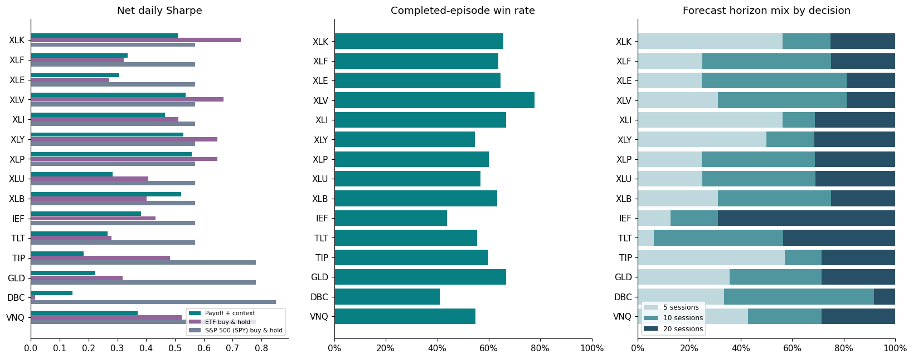

## Individual equity and drawdown curves

XLK

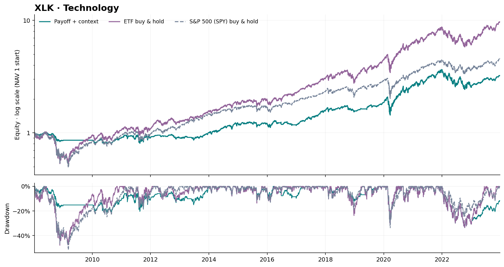

XLF

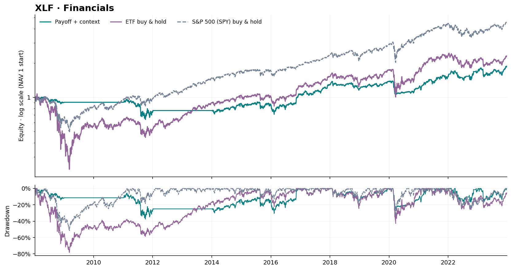

XLE

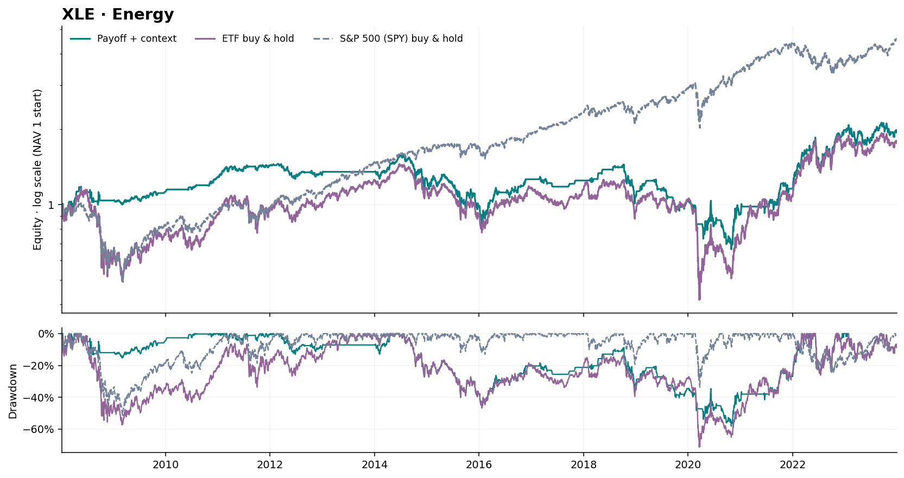

XLV

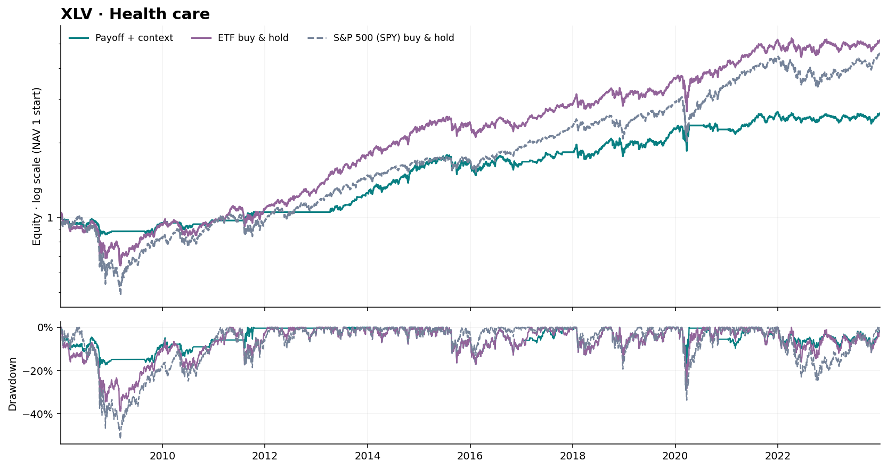

XLI

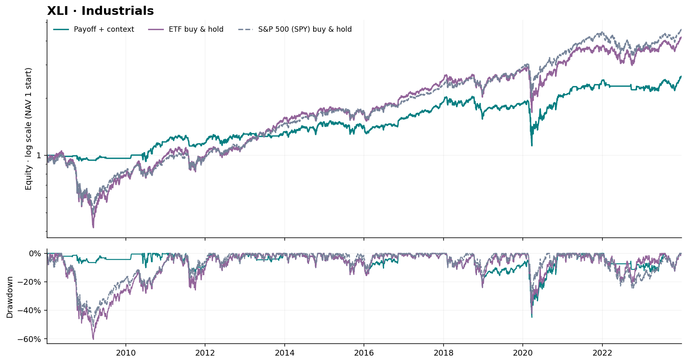

XLY

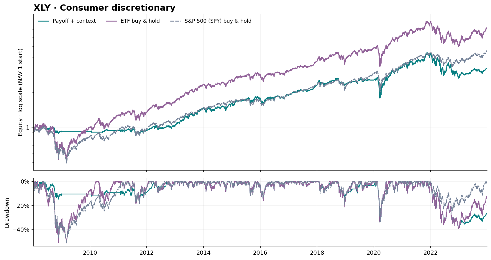

XLP

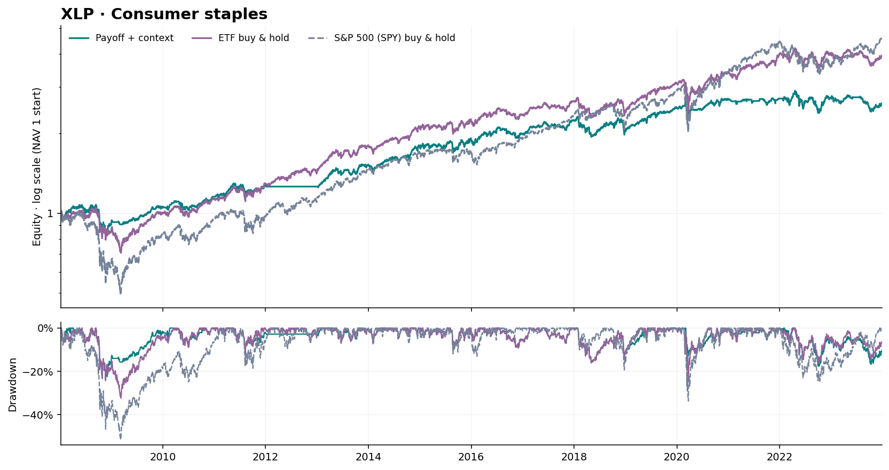

XLU

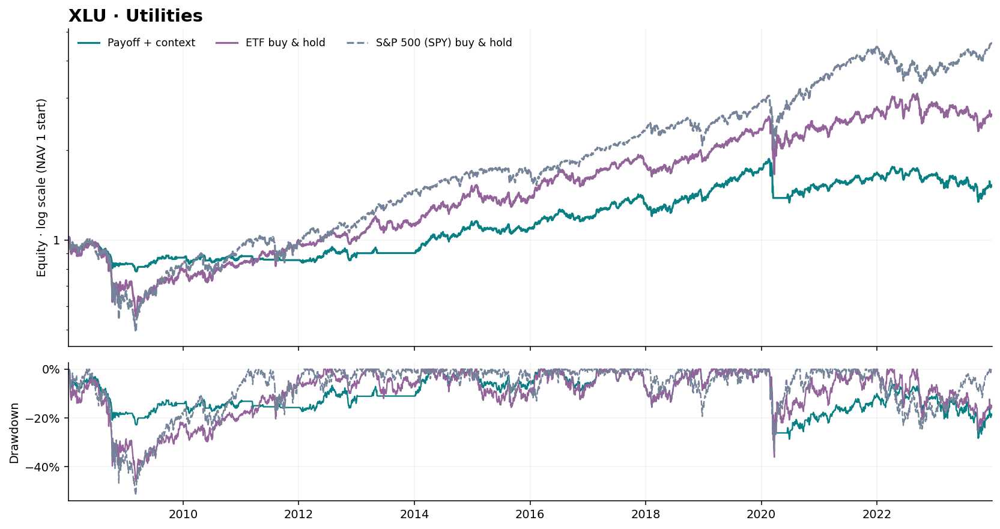

XLB

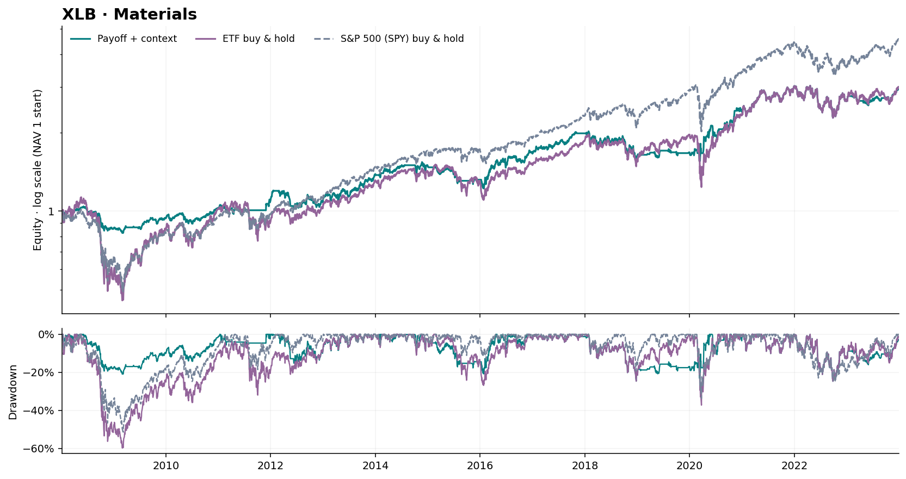

IEF

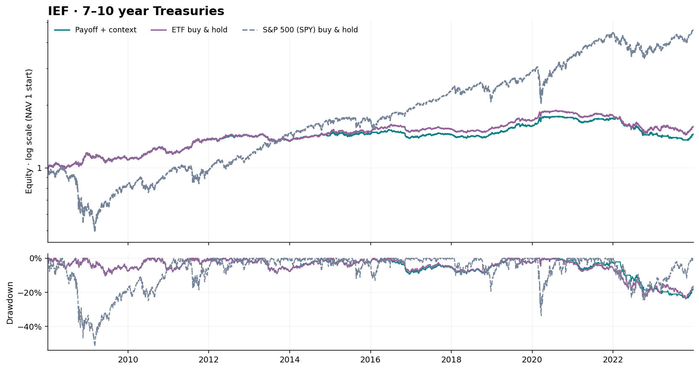

TLT

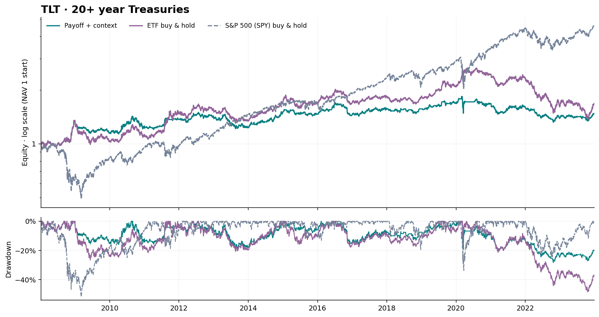

TIP

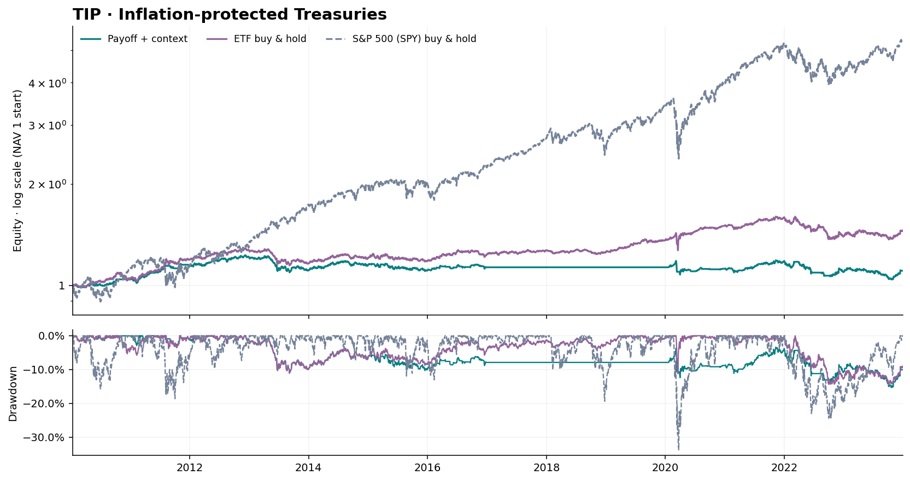

GLD

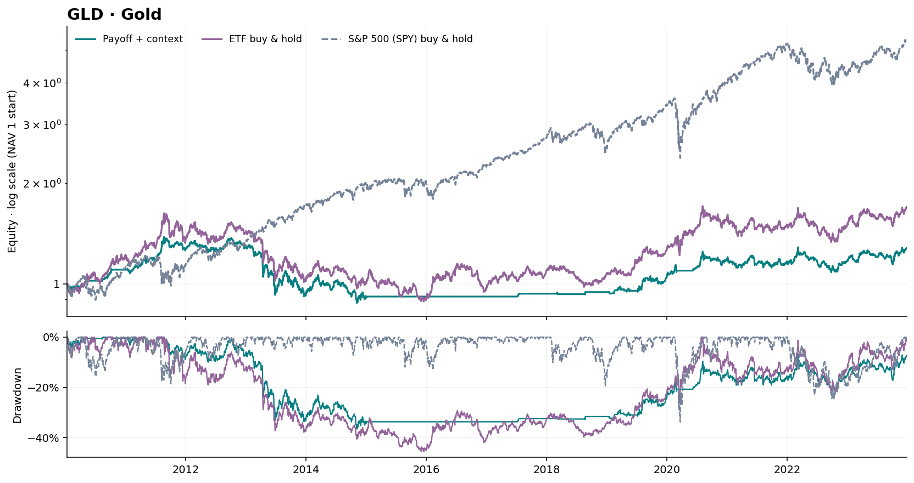

DBC

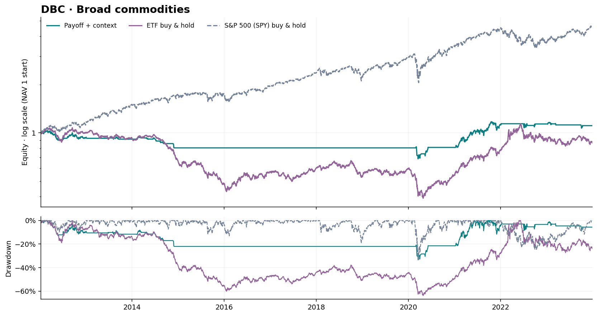

VNQ

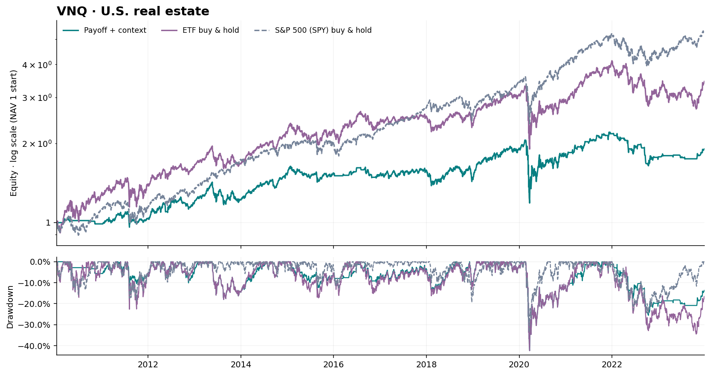

## Statistical coverage

The report includes annual/monthly returns; rolling Sharpe; Sortino, Calmar,
Ulcer and empirical tail risk; drawdown duration/recovery; episode expectancy
and concentration; position sizing/exposure/turnover/cost stress; horizon-aware
classification/regression and payoff reliability; earlier OOF calibration
support; factor usage/availability; exact weekly account intervals; common-period
stability; paired Sharpe uncertainty; and the 15-source evidence review.

The committed data/ is a reviewed reporting snapshot: derived account records,
forecasts, calibration records, statistical tables, pre-2024 session dates and
provenance. It contains no raw OHLC histories, news article corpus, model weights,
pickles, account credentials or reserved-period strategy scores.

The notebook reads these portable saved inputs. Raw downloads and full fitted
training runs remain local. reference_sources/ contains original source and
configuration snapshots for provenance, including historical local export helpers;
those reference helpers are not the supported notebook entry point.
