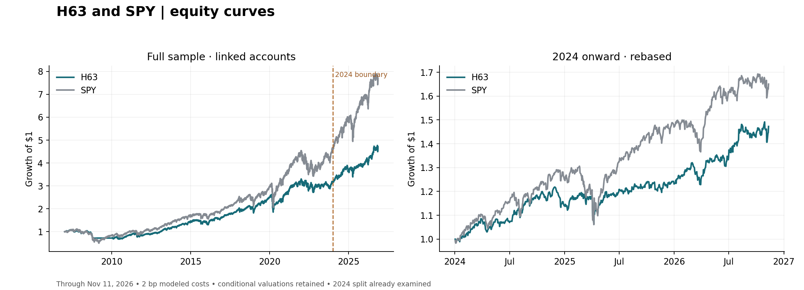
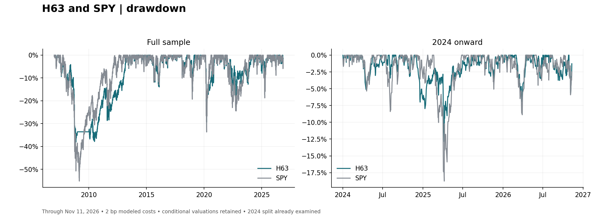

# H63 long-only benchmark

Frozen research release through **November 11, 2026**. H63 is the continuous-context, 63-session LambdaRank stock ranker combined with the original long-only capital policy. It is not the v39 long/short benchmark and does not include the later factor-family challengers.

## Results

| Period | Strategy | CAGR | Sharpe¹ | Maximum drawdown | SPY beta |
|---|---|---:|---:|---:|---:|
| 2007–2026 | H63 | 8.13% | 0.518 | −38.11% | 0.603 |
| 2007–2026 | SPY | 10.84% | 0.541 | −55.20% | 1.000 |
| 2024 onward | H63 | 14.53% | 0.829 | −12.88% | 0.530 |
| 2024 onward | SPY | 19.20% | 0.913 | −18.76% | 1.000 |

¹ Uses the research report's Treasury-rate proxy; the simulated account itself earns zero cash interest. Full precision and zero-rate Sharpe are in `reference/performance.csv`. Returns include 2 bp one-way modeled costs. The figures are conditional research results: **33 provisional valuation sessions and 2 aborted batches** remain in the full history. No adverse days were removed. The 2024 split has already been examined during research; it is not an untouched holdout. Historical holdings liquidate at the 2023 boundary and the forward account restarts in cash.




## Contents

- `h63.py`, `src/`: standalone frozen-model scoring, target construction, annual ranker fitting, capital-policy refitting with recorded penalties, and daily account replay.
- `checkpoints/`: 20 annual LambdaRank models and 20 annual capital-policy models, with fit metadata.
- `reference/`: strategy and SPY daily returns, account ledgers, decisions, exposures, metrics, ranking diagnostics and original quality flags. These support return analysis without licensed raw inputs.
- `charts/`: H63 versus SPY equity, drawdown, annual returns and H63 investment/beta behavior.
- `data_contract/`: exact private input manifest and feature schema.
- `provenance/`: source hashes, verification evidence, and upstream research recipes. Recipes document lineage; use the standalone launcher for supported commands.

## Reproduce

Use Python 3.12 and install `requirements.txt` in a virtual environment. Exact tested package versions are in `environment.json`. Raw vendor histories and prepared security-level feature/label arrays are **not redistributed**. Obtain the authorized `h63_private_inputs` pack separately. Keep it and all generated output outside the checkout. Only load pickle/PyTorch files from a trusted source after verifying the manifest.

```text
python h63.py verify --inputs /path/to/h63_private_inputs
python h63.py targets --inputs /path/to/h63_private_inputs --output /path/to/h63_run
python h63.py replay --inputs /path/to/h63_private_inputs --output /path/to/h63_run --part historical
python h63.py replay --inputs /path/to/h63_private_inputs --output /path/to/h63_run --part forward
python h63.py fit-ranker --inputs /path/to/h63_private_inputs --output /path/to/h63_refit --year 2024
python h63.py refit-capital --inputs /path/to/h63_private_inputs --output /path/to/h63_refit --year 2007
python charts.py
```

`targets` verifies every annual score and both target tables against frozen references. `replay` compares every shared numerical ledger field, not only headline performance. `fit-ranker` repeats annual H63 fitting from the prepared arrays. `refit-capital` repeats fitting with the **recorded selected penalty**, not the historical inner-validation penalty selection; original selection code and metadata are preserved for review. The supported reconstruction begins at the audited prepared feature/risk arrays. A fresh vendor download, universe reconstruction and full raw-data preprocessing are upstream processes, not a one-command feature of this release.

The private pack is about 1.34 GB. Run account windows sequentially on a machine with adequate memory (8–16 GB is a reasonable planning range). No API keys or paid data connection are needed to replay an authorized pack. The package contains research backtesting code, not a live broker adapter.

See [MODEL.md](MODEL.md) and [DATA.md](DATA.md).
